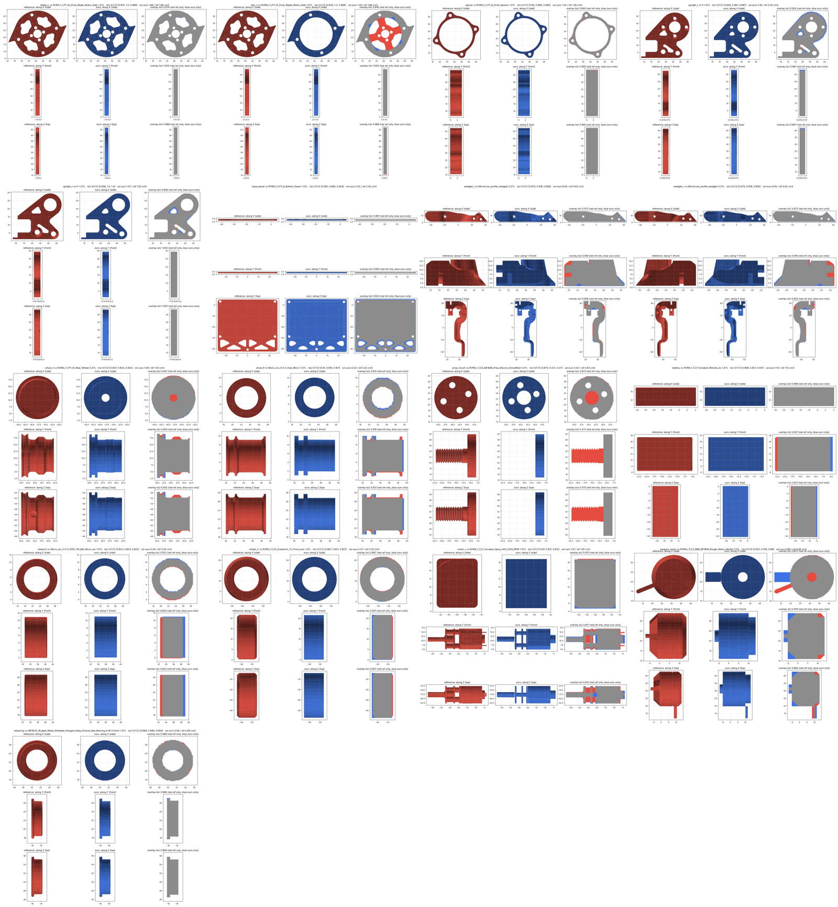

# Revron

Verifier (`aws2025`): passes. 0 blockers, 168 warnings, 361 checks passed. 45 items NOT CHECKED (see REPORT.md).

Mass 148.9 g (range 133.5 to 164.3 g).

| Top | Exploded | Section |
|---|---|---|
|  |  |  |

## Parts vs the RVRN reference CAD

Each modelled part against the RVRN drive CAD (measurement only, never imported), silhouettes along X/Y/Z: red is reference only, blue is ours only. Full table with IoU and volumes: [parts_compare/index.md](parts_compare/index.md).

## Files

- `spec.json`: the full editable design. Load it back with the robot tools to change and re-verify.
- `report.json`, `REPORT.md`: verifier output (REPORT.md ends with what was NOT CHECKED).
- `stl/`: one STL per part (mm, start pose, so they assemble when imported together; wires included).
- `step/`: exact B-rep STEP per part in the start pose, plus `assembly.step` with every part.
- `renders/`: iso, top, back, exploded and section views.

Regenerate: `python3 -m robot export spec.json revron <dir>`
