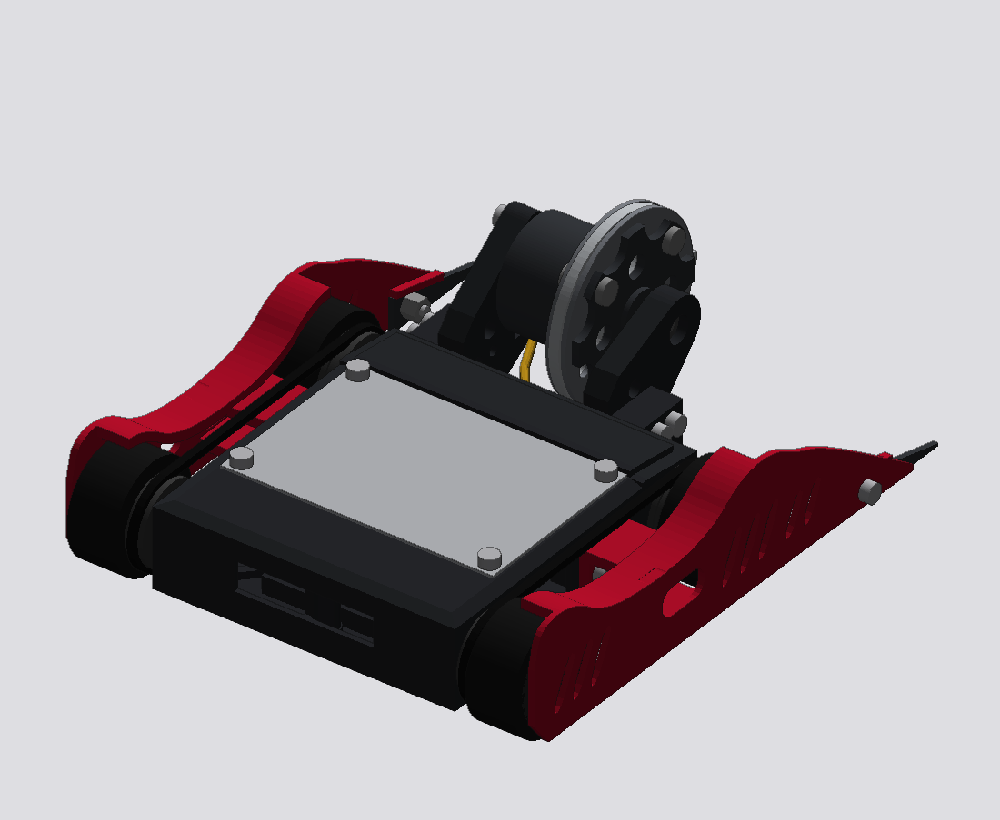
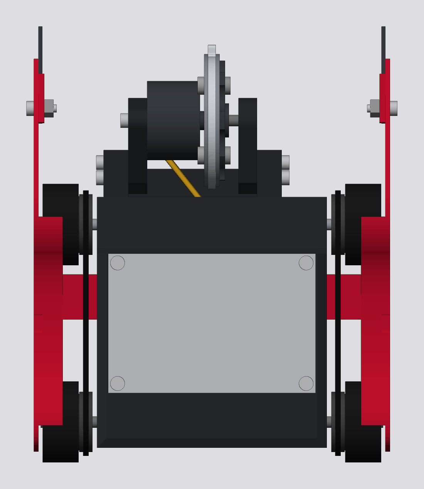
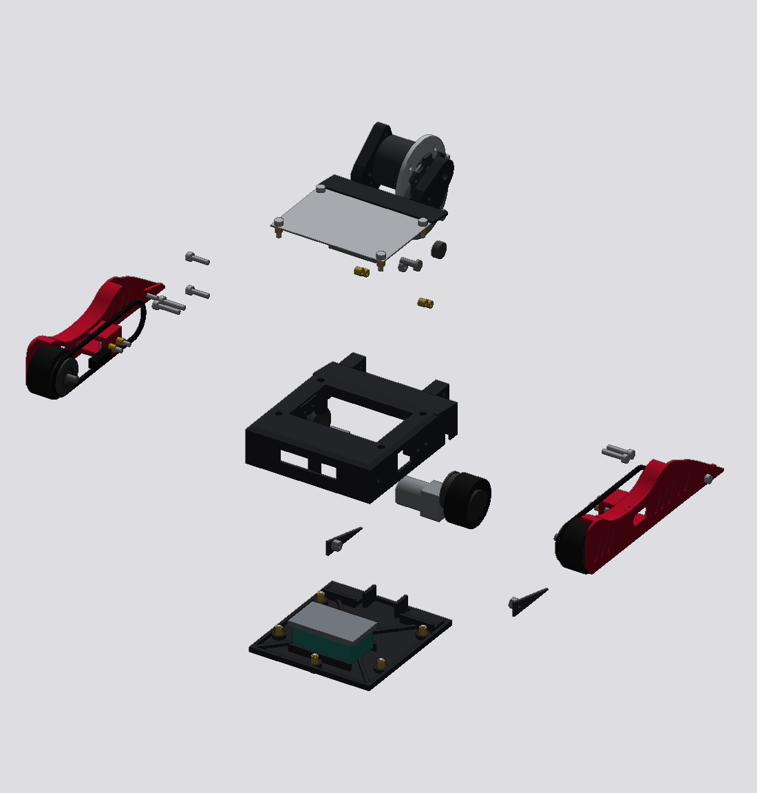
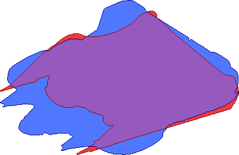
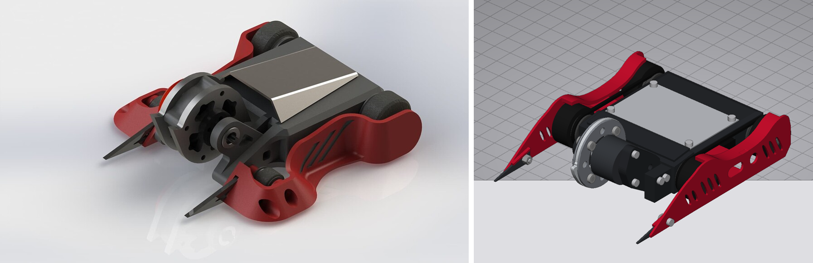
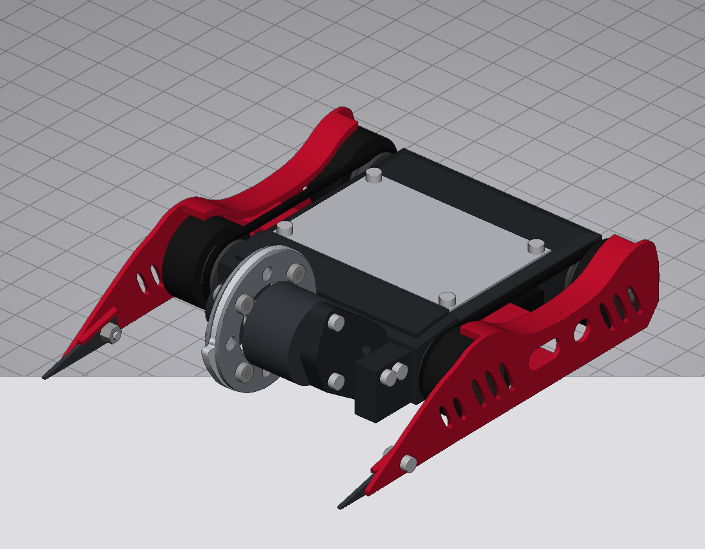

# Revron

Verifier (`aws2025`): passes. 0 blockers, 158 warnings, 271 checks passed. 49 items NOT CHECKED (see REPORT.md).

Mass 146.8 g (range 127.3 to 166.2 g).

| Top | Exploded | Section |
|---|---|---|
|  |  |  |

## Reference photo overlays (model red, photo blue)

## Files

- `spec.json`: the full editable design. Load it back with the robot tools to change and re-verify.
- `report.json`, `REPORT.md`: verifier output (REPORT.md ends with what was NOT CHECKED).
- `stl/`: one STL per part (mm, start pose, so they assemble when imported together; wires included).
- `step/`: exact B-rep STEP per part in the start pose, plus `assembly.step` with every part.
- `renders/`: iso, top, back, exploded and section views.

Regenerate: `python3 -m robot export spec.json revron <dir>`

## Photo vs render

Source: `src/build_revron.py` builds all geometry from `params.json`. It writes `spec.json` and `robot/templates/revron.json`.

Silhouette IoU against the photos: side 0.87, iso 0.69. The 0.88 target is not met. Iso fits worst at the front (0.45), where the photo's bulky weapon hub fills the frame and this model shows a 23 mm motor can behind a 40 mm disc (accepted).

## Remaining warnings and why they stay

The verifier reports 0 blockers and 158 warnings. Grouped:

**Combat edge and ground (R001-R016, R041, R082, R085, R090; dynamics.invertible; spinner.invert; ground.wheel_exposed; archetype.pods_enclose_wheels; shape.armour_coverage)**
This vertical spinner has two spike forks and open wheels, like the real Revron. It is not a full-width wedge, so the edge-gap rules for wedge bots fail by design. It is not invertible, as declared in `can_run_inverted: false`.
- R085 / ground.clearance: the countersunk base screws sit 0.25 mm below the -0 plane because the base panel is set 0.5 mm into the wall rim. The tyres carry the robot at -2.25.
- pods_enclose_wheels: the pods are outboard of the wheels. The heuristic misses them because the pods start 1.1 mm beyond the hubs.

**Weapon sizing (spinner.mass_share, spinner.energy_low, archetype.weapon_mass_fraction, archetype.energy_ratio, archetype.disc_thickness, arch.weapon_teeth, spinner.reach, archetype.blade_lead)**
These are fixed by `params.json`:
- The disc is 40 mm with a 2 mm tooth plate and 2 x 1 mm rings.
- The motor is a BE1806 and the 150 g budget applies.
- The rotating mass is 28 g (19 %).
- The single hook tooth stands 2.4 mm proud, below the 3 mm `weapon_teeth` heuristic.
- Blade lead is 4.9 mm against the 5 mm minimum.

**Weapon support (strength.bearing, strength.upright, arch.weapon_centred, arch.support_parent, kin.balance_static, interference.spin_clearance)**
- The F683 static rating is below the 100 g design hit, the same as the original.
- Uprights are 5 mm nylon.
- `upright_l` is parented to `upright_r` on purpose: the weapon is a quick-change module (both uprights, motor and rotor) that lifts out once the 4 boss screws are out.
- The blade-ring clearance warning is between parts of the same rotor.

**Joints and fasteners (head_proud, head_bearing, head_seat, insert_boss, no_locator, bolt_spread, single_fastener, loose_nut, service_access, assembly_dir, layer_tension, hole_spacing, retention.loose, symmetry*)**
- Button heads on the Ti plate stand proud.
- Pod screws bear on TPU; washers are recommended.
- The base screws are countersunk into a 1 mm skin.
- The upright bosses are 6.5 mm, so the two boss screws are 4 mm apart.
- Each spike has one screw plus a moulded ledge key.
- The rotor parts are flagged "loose" by the captive test because they are held by their own screws, which the test does not model.

**Electrical (battery C rating, runtime, ratings unknown, no LED, switch_rating, switch.drive_axis / too_deep)**
- The 2S 180 mAh pack was chosen for mass and gives about 1.8 min at match duty. A 300-350 mAh pack fixes runtime but costs about 8 g.
- The catalog has no current ratings for the BBB ESCs.
- The switch is recessed 6 mm on purpose (tool-operated).

**Manufacturing (printability.overhang / bridge on the tub, mfg.thin_wall 0.8 mm base skin and upright insert walls, tension.belt_stretch, wiring.bend, wire exposure)**
These are minor print and assembly notes. The O-ring belt stretch figure is from the catalog's nominal length.

**mass.may_be_over**: the nominal mass is 146.8 g. Weigh the catalog parts and set `scale_mass_g`.
