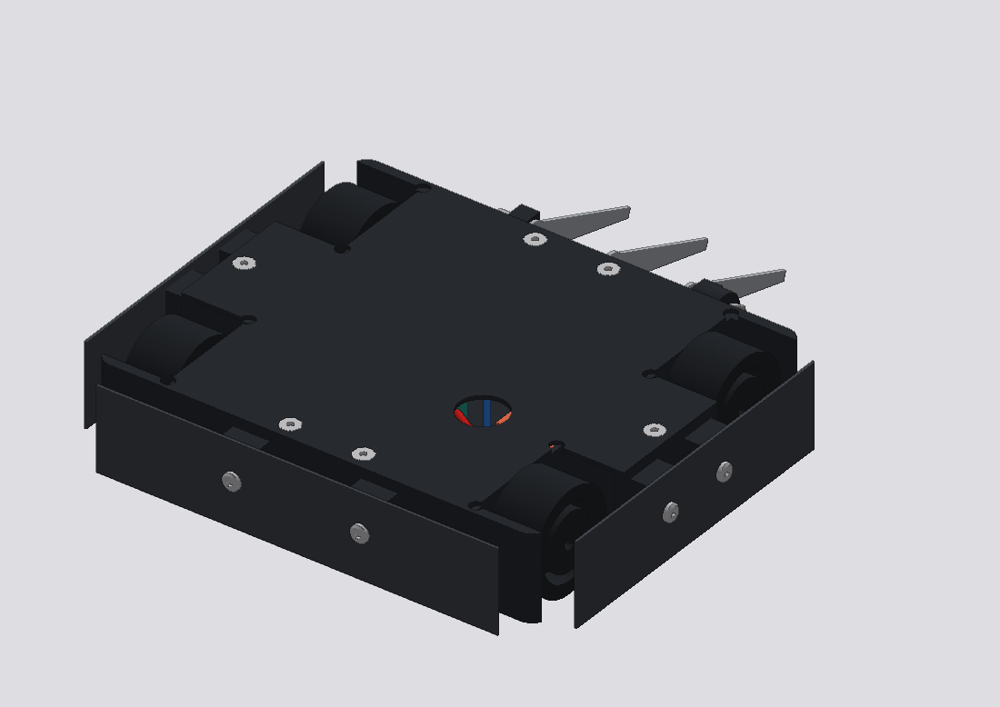
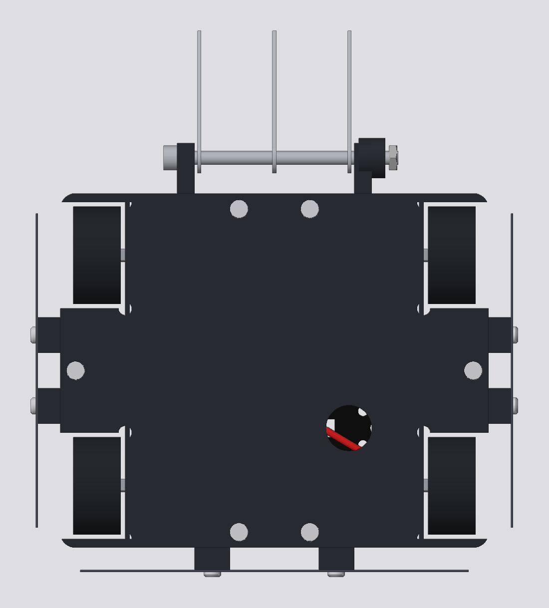
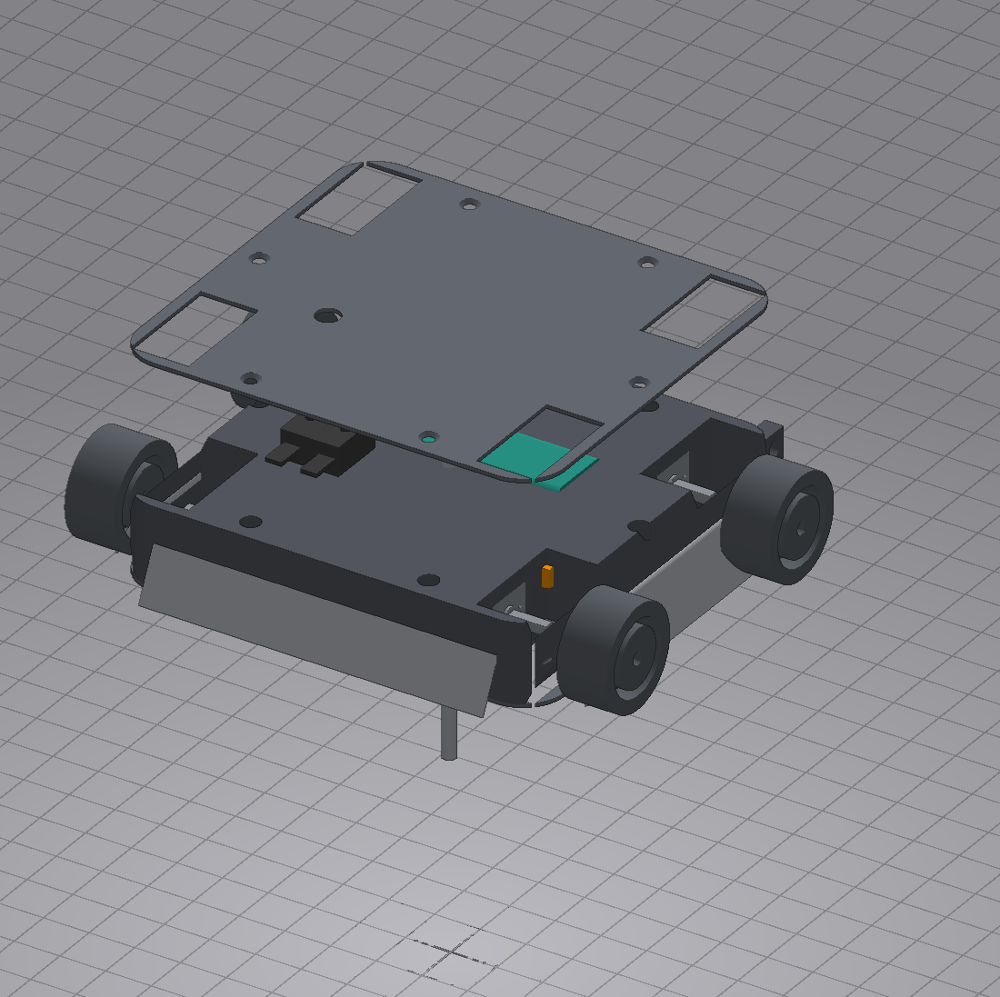

# Undertow (4WD invertible wedge / control bot)

Verifier (`aws2025`): ok=True — 0 blockers, 291 warnings, 367 checks passed. Mass 148.8 g (limit 150 g).

Switch note: the archetype prefers a side-reachable switch; Undertow's switch is reachable from the top
(sky hole in both plates) only, so `switch_access` stays a warning, not a blocker.

Mass 140.4 g (range 129.8 to 151.0 g).

| Top | Exploded | Section |
|---|---|---|
|  |  |  |

## Files

- `spec.json`: the full editable design. Load it back with the robot tools to change and re-verify.
- `report.json`, `REPORT.md`: verifier output (REPORT.md ends with what was NOT CHECKED).
- `stl/`: one STL per part (mm, start pose, so they assemble when imported together; wires included).
- `step/`: exact B-rep STEP per part in the start pose, plus `assembly.step` with every part.
- `renders/`: iso, top, back, exploded and section views.

Regenerate: `python3 -m robot export spec.json undertow <dir>`
