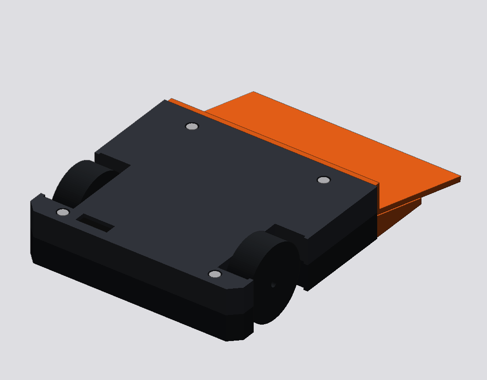
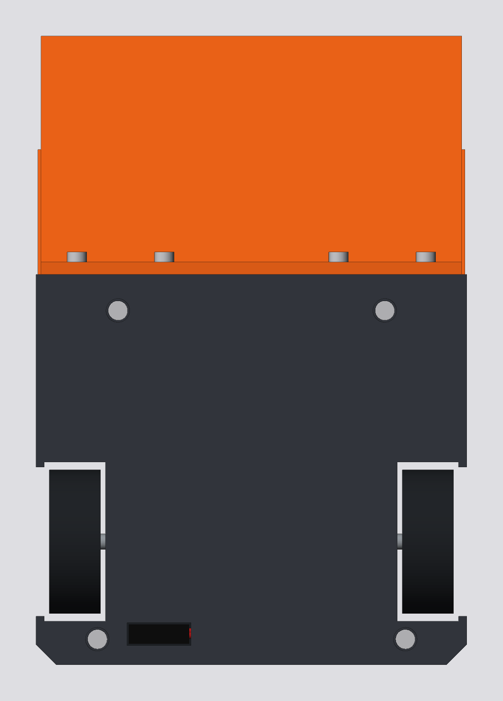
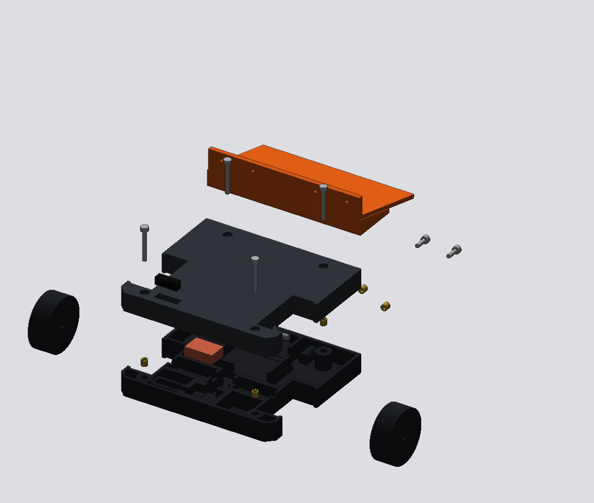
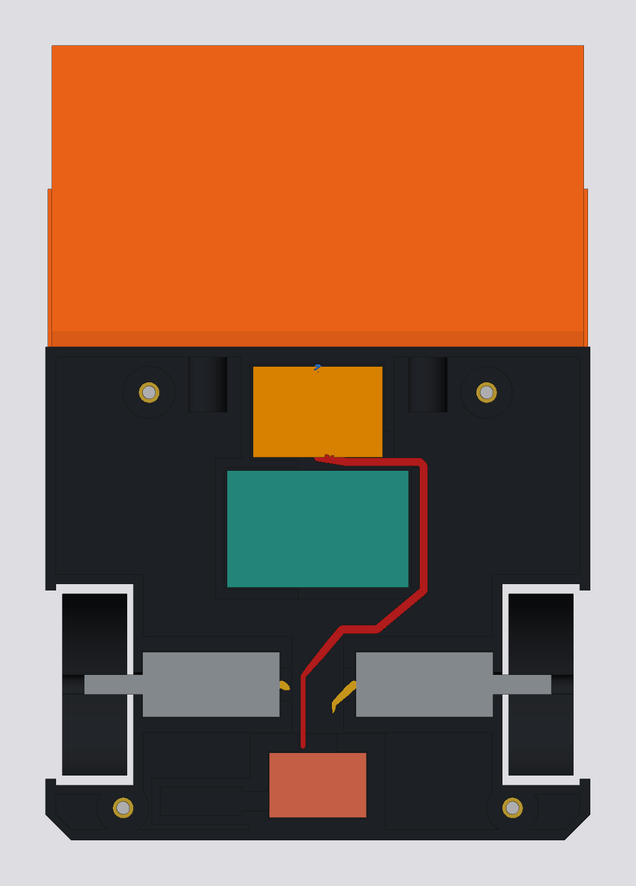

# Reference 2WD wedge

Verifier (`aws2025`): passes. 0 blockers, 3 warnings, 36 checks passed. 6 items NOT CHECKED (see REPORT.md).

Mass 114.6 g (range 93.6 to 135.6 g).

| Top | Exploded | Section |
|---|---|---|
|  |  |  |

## Files

- `spec.json`: the full editable design. Load it back with the robot tools to change and re-verify.
- `report.json`, `REPORT.md`: verifier output (REPORT.md ends with what was NOT CHECKED).
- `stl/`: one STL per part (mm, start pose, so they assemble when imported together; wires included).
- `step/`: exact B-rep STEP per part in the start pose, plus `assembly.step` with every part.
- `renders/`: iso, top, back, exploded and section views.

Regenerate: `python3 -m robot export spec.json wedge_2wd <dir>`
